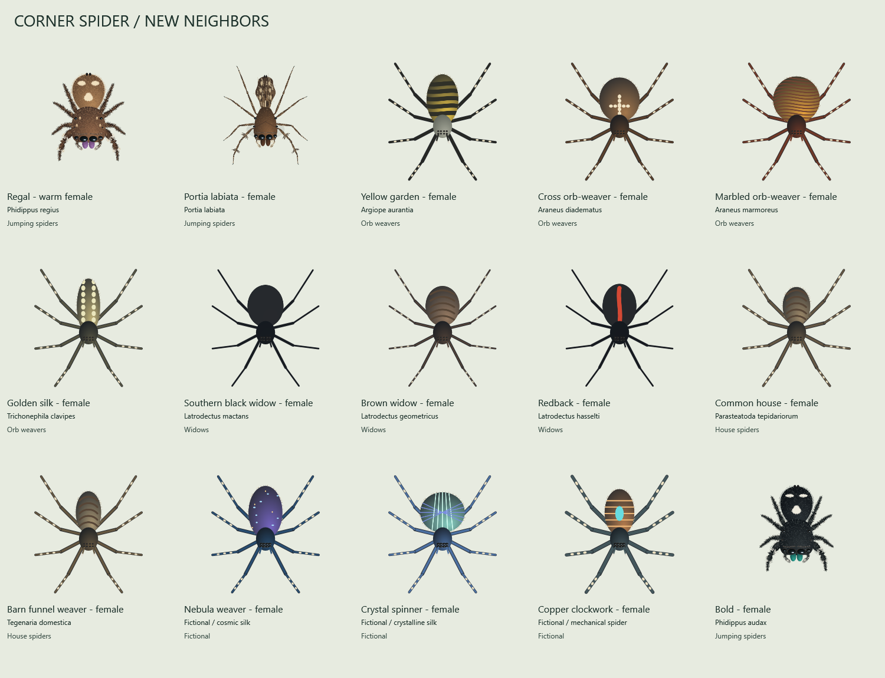
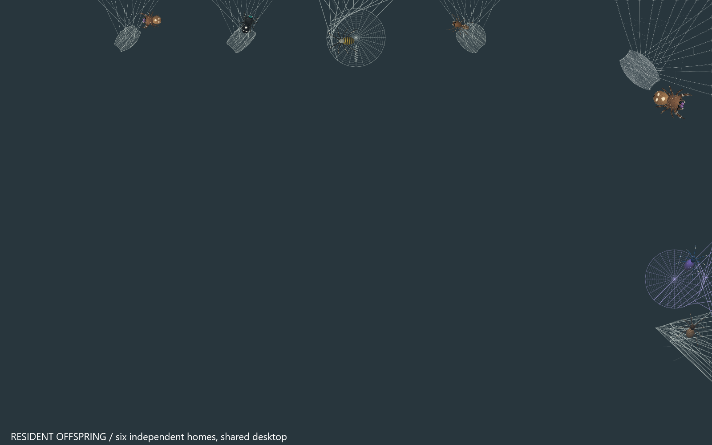

# Corner Spider 1.1 preview

A spider companion for your actual Windows desktop. This is **1.1.0-alpha.13**,
a prerelease for community testing. The [1.0 release](https://github.com/tedparkes/corner-spider/releases/tag/v1.0.0)
remains the stable version. [Download this preview and read its release notes](https://github.com/tedparkes/corner-spider/releases/tag/v1.1.0-alpha.13).

Extract the Windows ZIP and open **JumpingSpider.exe**. Windows 10/11 with .NET
Framework 4.8; no installer, administrator rights or asset downloads. Startup is
opt-in. This community build is unsigned.

## New in this preview

Alpha.13 adds **Check for updates** to the tray menu. Choose a different tray
shortcut setting in **Settings > Updates**.

Alpha.12 gives real male orb weavers mate-search patrols and occasional visits
at the edge of a same-species female's orb. The mating-visit setting controls
whether the female appears.

Alpha.11 revises leg placement and gives jumping spiders a brief raised look
between moves. Orb weavers approach trapped prey along their web spokes.

Alpha.10 has the spider hop between monitors, including across shared edges.
It lands on the next screen and carries on with its route.

Alpha.9 adds a one-time prerelease check and gives orb-weaver capture webs about
twice the room across both dimensions when the display can accommodate them.

Alpha.8 gives the cocoon more room across its body and extends its opening into
the room. [Same-scale comparison](docs/roomier-cocoon.png).

Alpha.7 fits the cocoon into the vertex with tapered silk along both sides.
The spider enters and backs out through the room-facing opening.
[Compare the placement](docs/corner-sleeve-comparison.png).

Alpha.6 opens up the Cross orb's capture spiral and brings silk sleeves closer
to their corner with short ties along both edges. [Before and after](docs/VERIFICATION-CROSS-RETREAT.md).

Alpha.5 rebuilds orbs, cobwebs, funnel sheets, and silk retreats around real
desktop-edge attachments. [Design review and verification](docs/VERIFICATION-CORNER-WEBS.md).

Alpha.4 adds anti-aliasing for fine web strands, including the settings preview.
[Rendering checks](docs/VERIFICATION-WEB-AA.md).

Alpha.3 corrects prey-web construction: complete the frame and all straight spokes,
then weave the interior spiral. [Construction preview and checks](docs/VERIFICATION-WEB-BUILD.md).

- **46 choices in five categories:** Jumping spiders, Orb weavers, Widows, House
  spiders and Fictional. All 23 varieties have male and female options.
- **A lived-in home:** persistent reinforcement, repairs and small remains build
  up over active hours near the nest. Existing threads stay in place. New web
  families use radial orbs, irregular tangles, sheets and funnel openings, attached
  to both edges of the desktop corner.
- **Occasional molts:** return home, shed a visible old cuticle, emerge 16% larger,
  then gradually settle back to your selected size. Growth never accumulates.
- **Female life cycles:** a same-species male approaches, courts and mates. He
  usually leaves; some real-species visits end in a meal. The female becomes
  visibly gravid, lays an egg sac, and six tiny spiderlings hatch, grow near home
  and eventually disperse off screen. Babies and resident offspring do not reproduce.
- **Optional resident offspring:** let babies stay, grow and build independent nests. A slider caps resident offspring at 1–12 (default 6); new young disperse if space or the limit is reached. Residents do not reproduce or take over cursor play.
- **GitHub updates:** manual checks and opt-in daily checks, with a stable/preview channel and a verified download-and-restart button.
- **Seven foods:** fly, gnat, moth, cricket, mealworm, beetle and small spider.
  Select one from the tray's **Choose food** submenu. Automatic food varies by
  spider type. Only one prey animal is present at a time.



[All 46 options](docs/skins-light.png) · [Dark gallery](docs/skins-dark.png) ·
[Fresh and lived-in webs](docs/living-webs.png) · [Life around the nest](docs/life-cycle.png)

## Start and settings

Extract the whole Windows ZIP to a permanent writable folder. Open
**JumpingSpider.exe** or **Start-Spider.cmd**. The Source ZIP needs **Build.cmd**
first. Right-click the spider tray icon and choose **Settings**, or double-click
it. A single pet runs per Windows session, shared between 1.0 and this preview.

- **Appearance:** category and species, live preview, 20–180% size, web visibility,
  light/dark background and preview rotation. The corner thumbnail uses the same
  web artwork as the desktop.
- **Life & home:** enable or disable future molts and mating visits, adjust their
  intervals, read the current stage, or **Invite a mate** for an available female.
  Allow offspring to stay and set the resident limit.
- **Finger:** skin tone from deep brown to pale, with a live preview.
- **Behavior:** occasional prey, finger play, interaction distances, hover delay,
  movement tolerance, species personalities and Portia's web encounter.
- **Desktop:** nest corner and home monitor, one/all monitors, optional startup.
  The rightmost monitor remains the default home.
- **Updates:** check GitHub, opt into daily checks or previews, and install a
  newer release with Download and restart.

Defaults use **active simulation time**, not elapsed time while the PC is off:

| Event | Default |
| --- | --- |
| First extra home reinforcement | 30 minutes near home; later layers more slowly |
| Molt | Every 6 active hours, waiting for a quiet moment |
| Shedding and recovery | About 45 seconds, then 90 seconds |
| Female mating visit | After 8 active hours; another visit waits until after the brood |
| Becoming gravid | 30 minutes after the visit |
| Egg incubation | 45 minutes after laying |
| Spiderlings near the nest | 90 minutes, then about 75 seconds to disperse |

Molt interval is adjustable from 2–24 hours; mating interval from 4–48 hours.
Pausing, sleeping/locking Windows and closing the app stop the clocks. Switching
skins pauses that skin's life history. Returning to it restores progress. Disabling
an option prevents future events; an event already under way finishes. Resetting
preferences keeps accumulated silk, meals and life history; it also turns resident mode off and sends resident offspring away.

These are species-inspired illustrations and deliberately compressed life events.
The repeating molt/size cycle is fictional, and mating outcome weights are artistic
choices, not biological statistics. Fictional males always leave. Orb-web aging
represents enduring supports and repairs; real capture webs may be replaced.
[Research and adaptations](docs/LIFE-RESEARCH.md) explain the choices.

## Species and webs

- **Jumpers:** Regal, Bold, Zebra, Tan, Red-backed, Emerald, Gray wall, Pantropical,
  Apache, Portia labiata and Hyllus diardi, all with both sexes. The green female
  Hyllus remains a labeled stylized variant; the new male is brown.
- **Orb weavers:** Yellow garden (Argiope aurantia), Cross (Araneus diadematus),
  Marbled (Araneus marmoreus) and Golden silk (Trichonephila clavipes).
- **Widows:** Southern black, Brown and Redback. The dorsal drawings do not place
  an underside hourglass on the back. Brown widows have spiky egg sacs.
- **House spiders:** Common house (Parasteatoda tepidariorum) and Barn funnel
  weaver (Tegenaria domestica).
- **Fictional:** Nebula weaver, Crystal spinner and Copper clockwork.

The new families have small eyes/front bodies and longer, thinner legs rather
than enlarged jumper faces. Web dwellers remain near home and walk to prey caught
in the web; jumping spiders retain long stalking approaches and pounces. Original
species IDs, procedural drawings and varied silk retreats are preserved.

## Play and food

Hold the cursor near an awake, available spider. The finger begins to appear after
4.5 seconds by default. Small hand jitter is tolerated. The spider chooses a
landing spot, walks around, sometimes waves, or catches the exposed fingertip and
climbs up. Carry it gently. Clicking plans an upward departure; fast movement
triggers an immediate escape with a silk dragline. Clicks still reach your apps.
The pointer returns on departure, pause or exit, with a watchdog for interruptions.

Life events briefly take priority over food and finger offers. A male visitor and
up to six babies are family members with behavior, separate from the single
prey slot. Feeding does not replace live prey. The quick tray feed remains a fly
(or a small spider for Portia); **Choose food** exposes all seven foods for any
species. Automatic web-dweller food is mainly winged insects and beetles; jumpers
also encounter crawling foods. Portia still favors small spiders.

Portia retains its longer corner-web hunt: **Behavior > Invite a web-building
spider** starts construction over 3–4 minutes, followed by a 1–2 minute wait.
Portia approaches an anchored side, plucks five times, watches the resident creep
closer, then attacks directly and briefly struggles with it. That web stays until
Portia leaves. The encounter shares the single prey slot and waits during life events.

## Updates and resident offspring

**Settings > Updates** has **Check now** and an opt-in daily check. Enable
**Include prereleases in regular checks** to consider stable and preview builds
together. **Check for prerelease** looks for the latest compatible preview once.
**Check for updates** in the tray menu opens Updates and checks the saved channel.
The tray shortcut defaults on in preview builds and off in full releases.
Use **Download and restart** when a newer build is offered. Updates require
your confirmation and a version newer than your current installation.

On Alpha 2 or Alpha 8, enable **Include preview releases** and select **Check now**.
On Alpha 9 or newer, **Check for prerelease** works without changing your saved
channel. Version 1.0 users can move to the preview by quitting the previous pet
and extracting this Windows ZIP.

Checks read the public GitHub releases API for `tedparkes/corner-spider`; downloads
come from that repository and GitHub's asset servers. No pet history, settings or
personal files are uploaded. With automatic checks off, the application contacts
GitHub only when you use an update button. An unavailable network or GitHub rate
limit leaves the pet running and can be retried later.

Before installing, the app saves progress, downloads the Windows ZIP and release
checksums, verifies SHA-256 and the executable version, and validates archive
paths and size limits. A hidden helper waits for the app to exit, backs up replaced
files and installs into the same folder. It restarts the pet afterward. Copy errors
roll back the changed files. Saves, startup paths and Desktop shortcuts are kept.
Updates require a writable app folder, not administrator privileges. Results and
backups live under `%LOCALAPPDATA%\CornerSpider-Next\updates`; old staging folders
are pruned on later downloads, retaining the two most recent folders before staging
a new download. These unsigned releases rely on the project's GitHub account and
HTTPS; checksum validation is not code signing.

**Settings > Life & home > Let babies stay and build their own nests** is off by
default. At the end of the brood phase, available places are assigned along real
outer desktop edges. Young travel there, grow over about two active hours to 65%
of the main pet's selected size, and weave species-appropriate smaller homes.
They move, rest and groom independently, keeping their species and progress when
you change the main pet. This applies to future brood departures; it does not
summon offspring instantly. Their automatic feeding and cursor play are disabled
so the desktop retains one prey slot and one finger interaction.

The limit is global across species, up to 12 resident offspring in addition to the
main pet and its temporary family. Smaller displays may have fewer suitable sites.
New residents avoid the main retreat and Portia's reserved prey web; Portia also
avoids building a prey web over an established resident home. Lowering the limit
sends excess residents away; unchecking the option sends all residents away over
about a minute, fading their empty nests after they leave. Display changes relocate
homes or send residents away if no space remains. Population and homes are saved.



## Saves, privacy and removal

This preview uses **%LOCALAPPDATA%\CornerSpider-Next\settings.txt** and a previous-save
`.bak`. On first launch it copies existing 1.0 preferences from
`%LOCALAPPDATA%\CornerSpider\settings.txt` if available; it leaves that original
save untouched. Normal quit saves progress. Use **Stop-Spider.cmd** or Quit in the
tray. To switch back to 1.0, quit the preview and start the original installation.

The pet simulation runs locally. No telemetry, accounts, keyboard logging
or mouse injection. The optional **Buy me a coffee / Monster** button opens the
original bundled Cash App QR only, with no username label or payment link.
[Support details](docs/SUPPORT.md). Support is optional.

To uninstall, disable Start with Windows, quit, delete the app folder and optionally
its preview save folder. Startup is per-user and remains off by default. If moving
an installation with startup enabled, disable it first and re-enable from the new
location. Exclusive fullscreen apps and secure Windows screens can cover the pet.

## Build and verification

Run **Build.cmd** on Windows. It uses the installed .NET Framework compiler,
executes deterministic behavior/persistence tests and compiles WPF. No NuGet
packages or external artwork dependencies. Quit the pet before rebuilding.

```bat
Build.cmd
JumpingSpider.exe --self-test "C:\Temp\CornerSpiderChecks"
JumpingSpider.exe --life-preview "C:\Temp\CornerSpiderLife"
JumpingSpider.exe --colony-load-test "C:\Temp\CornerSpiderColony"
JumpingSpider.exe --release-preview "C:\Temp\CornerSpiderArt"
JumpingSpider.exe --desktop-test "C:\Temp\CornerSpiderManual"
```

Self-tests use isolated saves. Artwork commands render plain backgrounds without
capturing your desktop. The interactive fixture supports hands-on cursor testing.
[Preview verification](docs/VERIFICATION-NEXT.md) separates completed automated and
native tests from physical display/suspend and long-duration checks still needed.
The preserved [1.0 verification](docs/VERIFICATION.md) applies to 1.0 only.

**Package.ps1** creates entry-verified Windows and Source ZIPs, SHA-256 checksums
and draft release notes containing the full [changelog](CHANGELOG.md). It does not
publish. The next release retains WPF/.NET Framework for a small dependency-free
Windows app. See [contributing](CONTRIBUTING.md), [release instructions](RELEASING.md)
and [future work](ROADMAP.md).

Free software under the [MIT License](LICENSE). Original procedural artwork is
included; research photographs are not redistributed.
