# Corner Spider 1.0 RC10

A small jumping spider for your actual Windows desktop. It watches from corners,
stalks occasional prey, builds a silk retreat and sometimes accepts a finger ride.

See the [changelog](CHANGELOG.md) for changes and fixes by version.

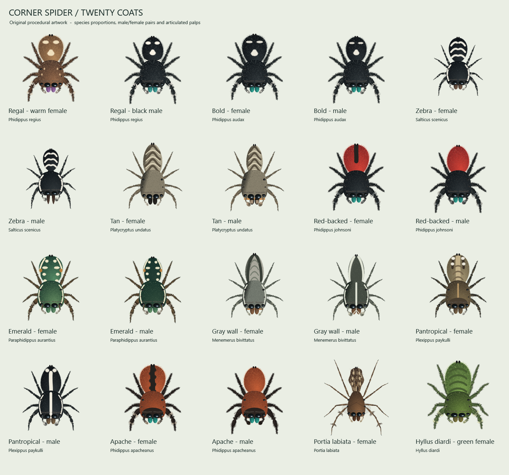
Portia's resident prey builds a larger corner web and waits at its center. Portia
reserves that corner, then steps onto the silk near an anchored end. One foreleg
plucks an existing strand while the other seven feet stay planted. After each of
five plucks, the resident turns toward the signal, stalks closer and pauses.
The web stays visible after the meal until Portia moves clear. The resident weaves
a corner-shaped web attached at eleven points along both desktop edges, with
a smooth, deeply concave outer bridge, radial spokes and curved spiral silk. The
middle sits about 30% closer to the corner than in RC8; both end anchors stay fixed.
The resident waits at its hub; Portia plucks beside one of those anchored ends
with direct foot contact and no extra connecting threads.

The Appearance preview includes each species' silk retreat in its upper-right
corner, with live skin, size, web-visibility and background changes. The saved
**Web visibility** slider runs from 0% (invisible silk) to 100% (the existing
appearance), covering the retreat, resident web and jump threads. Nest progress
is preserved.

All twenty skins received a [species-reference critique](docs/SKIN-REVIEW.md).
Portia is more angular and fine-legged; flat bark/wall species have shorter setae
and matte shading. The larger preview retains each species' details.

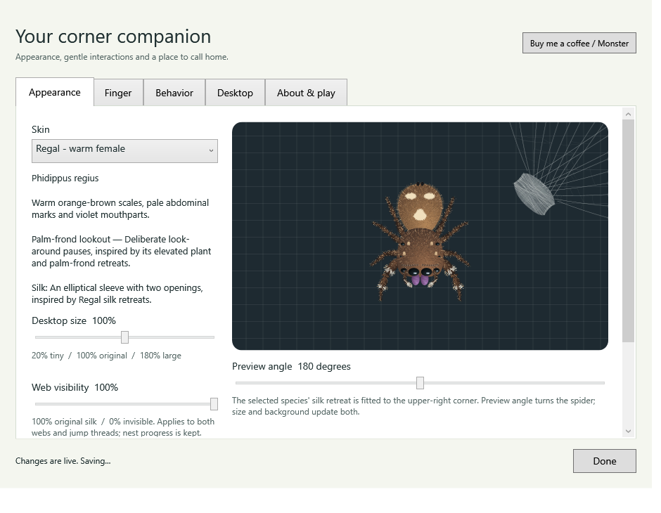

This is the **1.0.0-rc.10 release candidate**. Windows build and automated checks
pass; the remaining hands-on release checklist is in [verification notes](docs/VERIFICATION.md).

## Download and start

Use the **Windows ZIP** attached to a release, extract the entire folder to a
permanent writable location, and double-click **JumpingSpider.exe** or
**Start-Spider.cmd**. The GitHub source-code ZIP needs a local build first.

Windows 10/11 with .NET Framework 4.8 desktop components. No administrator rights,
installer, accounts or asset downloads. The pet works offline; the optional
support link opens Cash App in your browser only when clicked. Only one pet runs per
Windows session. This is an unsigned community build; Windows may display an
unknown-publisher warning. The release includes SHA-256 checksums.

Right-click the spider icon in the notification area (possibly inside the overflow)
and choose **Settings**. Double-clicking the icon also opens settings.

## Make it yours

- **Appearance:** twenty skins, a live animated preview, dark/light backgrounds,
  preview rotation and a **20–180%** size slider. Turn off “Enlarge preview for
  detail” to see the selected desktop size.
- **Finger:** adjust skin tone from deep brown (0%) to very pale (100%), with a
  live preview on light or dark backgrounds. Your shade is saved automatically.
- **Behavior:** enable occasional prey or finger play; use sliders for prey
  intervals, the finger delay, approach distance, loss-of-interest distance and
  the fast-movement escape threshold. Species personalities and Portia corner-web
  encounters have separate switches.
- **Desktop:** choose the hammock corner and screen, explore one or all monitors,
  and optionally start with Windows. The rightmost monitor is the default home.
- Reset preferences keeps nest progress, meals and the existing startup choice.

The tray keeps only Settings, feeding, go home, wake, pause/resume and quit.
For Portia, feeding reads **Release a small spider**; other skins show **Release a fly**.
Startup remains **off by default**.

## Play

Approach an awake spider and hold your pointer still. By default the finger begins
fading in after **4.5 seconds**, finishing around five seconds. Small hand jitter is
tolerated. It chooses different landing spots along the finger's solid upper
surface, briefly settles, then walks around and waves. From the exposed fingertip
side it may instead catch with its front legs, dangle and climb up. Approaches
from the base or above land on top instead of crossing the finger to hang.
Carry it gently. A click makes it choose a spot above the finger, turn, brace and
jump up with a short silk dragline. Near the top edge it makes a safe sideways hop.
If it is still hanging, it climbs onto the finger before taking off. The finger
holds still for this brief preparation, and your real pointer returns immediately.
Fast movement while riding still triggers an immediate startled escape.
Leave room inside the desktop for the finger.

The default approach distance is 185 logical pixels and the loss-of-interest
distance is 230. These scale with Windows DPI, not pet size, so a tiny spider is
still approachable. The exit distance stays at least 20 pixels farther away.
Hold inside the approach radius to complete the invitation.

Clicks continue to reach the applications underneath. During play the pointer
temporarily hides beneath the finger; it returns on departure, pause or exit.
A helper restores it if the pet exits abruptly or stops sending heartbeats.
Opening settings cancels an invitation and suspends cursor offers while you edit.

The spider mostly rests near corners, patrols in bursts, hunts in stages and returns
to its hammock. At most one prey animal exists. Automatic intervals vary by ±30%
around the slider value and wait until the spider is available. Feeding never
replaces live prey.

All twenty skins now launch their final hunting pounce from farther back. With
enough room, the leap covers about **3.5 times** the previous distance: roughly
200 logical pixels at 100% pet size, scaled for pet size and display DPI. Distant
prey still gets a stalking approach, followed by a pause, foreleg reach and crouch.
Already-close prey gets a shorter leap. The flight stays quick (about 0.32 seconds),
with a silk safety line and a lower arc when hunting along the top edge.

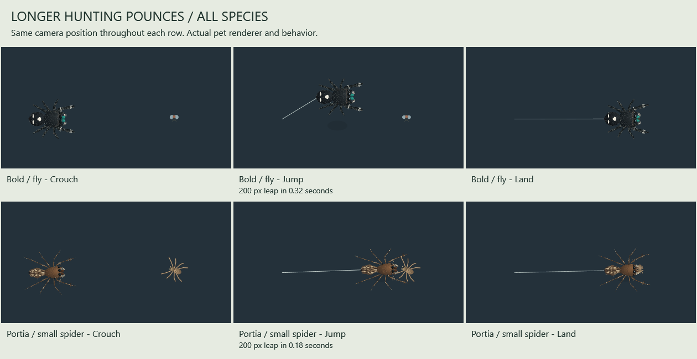

**Portia labiata hunts small spiders as well as flies.** With Portia selected,
about 65% of ordinary automatic spawns are small spiders; the rest are flies. The existing
occasional-prey switch and timing slider control both. The small spider crawls in
short steps and pauses, then Portia notices, stalks, lines up and pounces. Its legs
wriggle briefly while Portia braces, then fold as she settles into eating.
Portia's attack takes 130–190 ms with at most five logical pixels of lift;
ordinary travel, finger boarding and other species' jumps keep their original arcs.

To try it immediately, select Portia in Appearance and use **Release a small
spider** from the tray. Other skins continue spawning flies. Switching skins
preserves a prey animal already present and the meal already being held; the next
spawn follows the selected species. Prey is temporary, while meal totals persist.

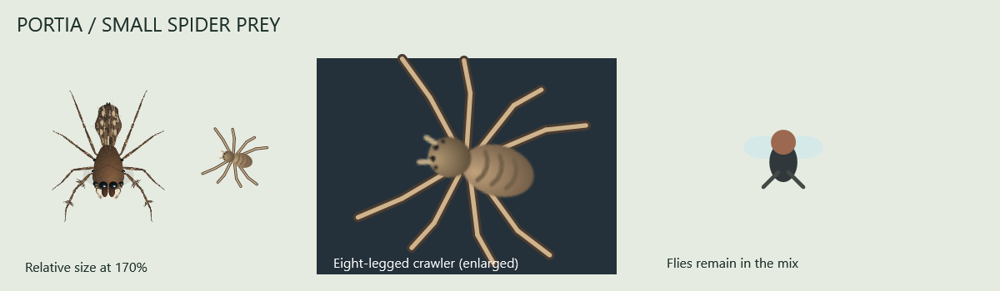
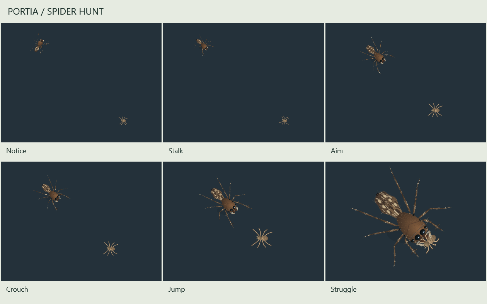

The hammock has a woven support base with attachment bundles spread along both
edges of its corner. Those bundles merge into the translucent sleeping sleeve,
so the retreat reads as secured silk rather than a floating cocoon. Fine cross
threads connect the supports, and existing threads remain stable as silk grows.

The selected species changes the sleeve proportions, weave density and supporting
structure: compact sleeves for smaller jumpers, lighter bark/crevice shelters,
a denser tangled tube for Pantropical, and an open scaffold around Portia's sleeping
platform. Most sex pairs share their species' silk; the Red-backed male has a
lighter tube. Several differences are artistic adaptations where evidence is
limited. [Silk reference notes](docs/SILK-REFERENCES.md) explain each choice.

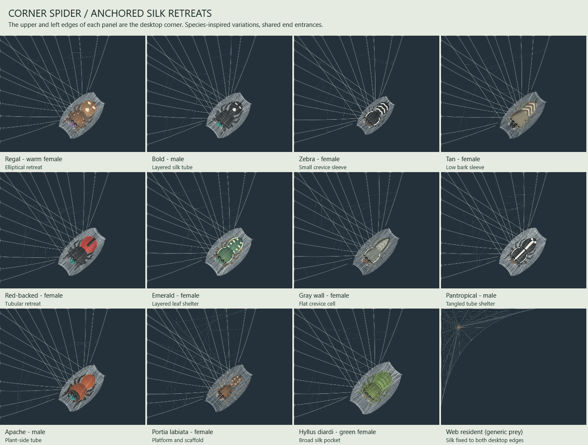
The spider walks around its outside, lines up at an end, pauses and crawls head
first under the silk. It folds its feet after arriving inside. On waking it
unfolds, then crawls out through the opposite end. Choose **Go to hammock** from
the tray to watch it return; **Wake up** shows the departure.
Existing silk progress carries over and gradually thickens the retreat.

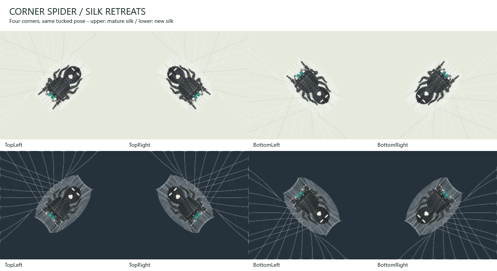
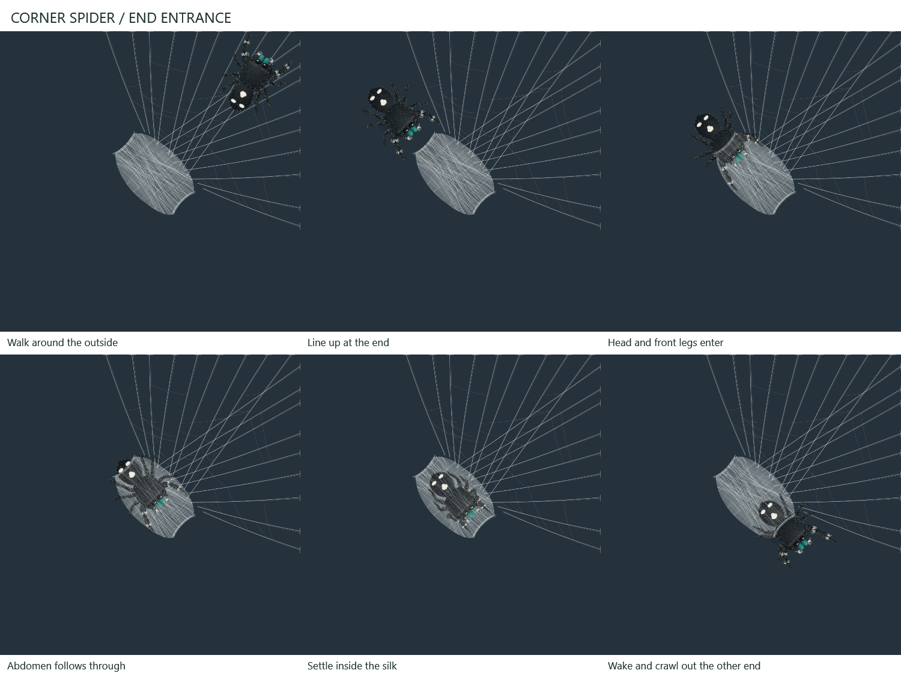

## Portia's corner-web encounter

Select **Portia labiata** in Appearance, then open **Behavior** and choose
**Invite a web-building spider**. A small resident walks its thread path while
constructing a connected corner web over **3–4 minutes**, then waits **1–2 minutes**.
Portia makes a cautious angled approach and steps onto the edge near an anchored
end. One foreleg makes five spaced plucks while the other feet remain planted.
Each signal makes the resident turn, advance a short distance and pause to listen,
as though stalking prey. Portia ambushes after the final approach. The empty web stays
visible while Portia eats or rests there; its 12-second fade starts after she moves
fully clear of the web.
The same fast, direct Portia attack applies to free-moving prey. Other species
keep their longer-distance, arcing hunting jumps.

Automatic encounters are occasional, require automatic prey and corner-web visits
to be enabled, and use the same single-prey slot. A free, roomy corner is chosen
away from Portia's hammock and current corner, including on another monitor.
The web has three times its earlier span, fitted down when needed to keep an
approach lane. Spider prey is 50% larger, still smaller than Portia. The resident
waits at the central junction and follows the signal toward an outer anchor;
Portia's plucking forefoot contacts silk at that edge. Ordinary patrols and returns detour
around the reserved footprint while the resident builds and waits.

Small layouts may have no suitable corner. Portia can nap or play on your finger
while the neighbor builds; the approach waits until Portia is available.
Pausing freezes the sequence. A skin, size, display or home change clears the visit
safely. Guest webs are temporary; your own hammock progress remains saved.

The tray's **Release a small spider** remains a quick ordinary hunt. Use the
settings invitation for the longer web-building encounter. Its progress is shown
in Behavior settings. Real web deception inspired this sequence, but the timing,
generic resident and response rules are designed for the desktop.

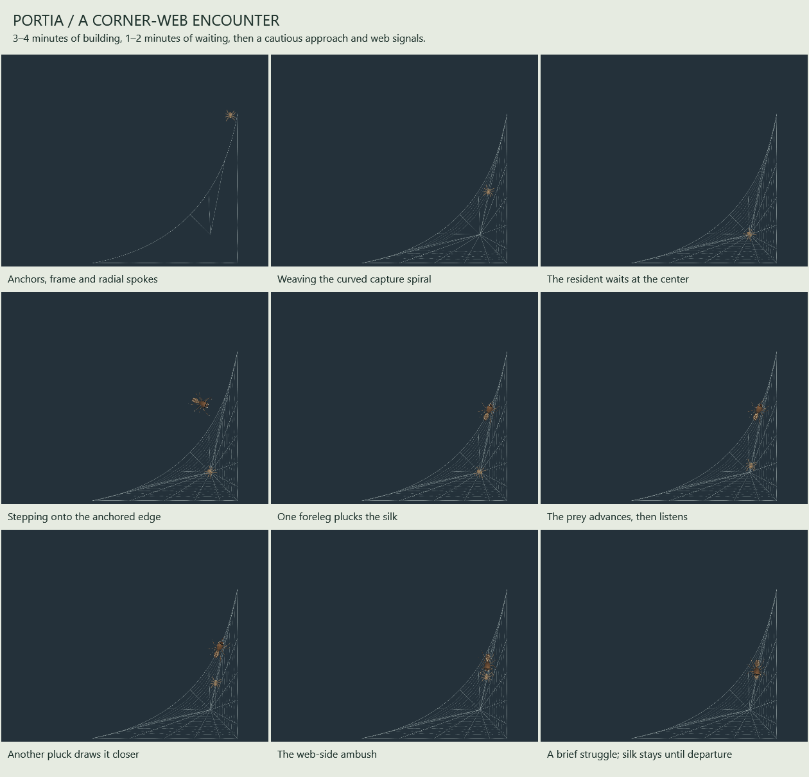
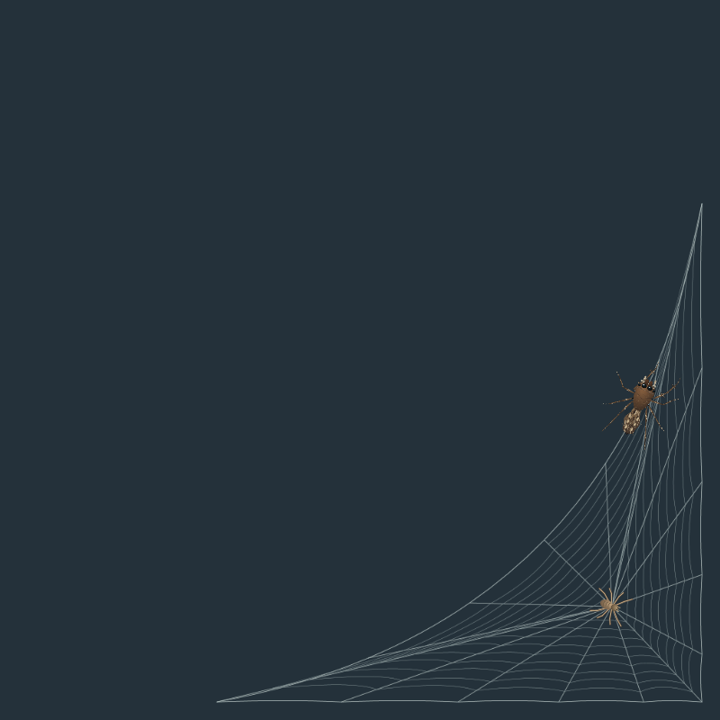

## Species personalities

All twenty skins have a personality description in Appearance, and the preview
cycles through characteristic poses. The desktop adds occasional gestures and
changes to patrol, stalking, meals or retreat visits. Examples include the male
red-backed jumper's raised-arm zigzag, Bold male foreleg drumming, Zebra's slowing
stalk, Tan's low still pauses and Apache's scouting or retreat preference.

These are short solo adaptations of observations, including some courtship
gestures. No mates, eggs or breeding system are simulated. Sex differences are
used where supported; several pairs deliberately share the same behavioral trait.
The green Hyllus's heavier tempo is explicitly an artistic choice.
[Research and limitations](docs/BEHAVIOR-RESEARCH.md) map each species to its sources.

## Optional support

The small **Buy me a coffee / Monster** button opens a flyout with the creator's
original Cash App QR, including its green logo. Click **$tedparkes** inside the
flyout to open the matching public Cash App page in your browser. Corner
Spider remains free. It has no payment SDK, login form or automatic payment flow.
Check the recipient in Cash App before paying. Sharing the code makes the public
payment profile discoverable; it is not a login credential.

Only the cropped QR card is included, not the original phone screenshot. Cash App
branding identifies the payment option and does not imply sponsorship. See
[support details](docs/SUPPORT.md).

## Skins

Twenty options across eleven species:

- Male and female: Regal, Bold, Zebra, Tan, Red-backed, Emerald, Gray wall,
  Pantropical and Apache.
- Portia labiata female: smaller angular body, long thin fringed legs and mottling.
- Hyllus diardi female: broad head, long full abdomen and eye tufts, in the
  requested **stylized green color variant**. Wild females are usually brown/yellow.

The shape profiles change abdomen outline and proportions, head width and length,
leg proportions and stance, chelicerae and palps. Adult males have fuller terminal
palp bulbs; females have finer tips. Grooming alternates sideways eye wipes and
chelicera strokes while the walking forelegs stay planted. The live preview shows
both the front-leg greeting and palp grooming. All original saved skin IDs remain valid.

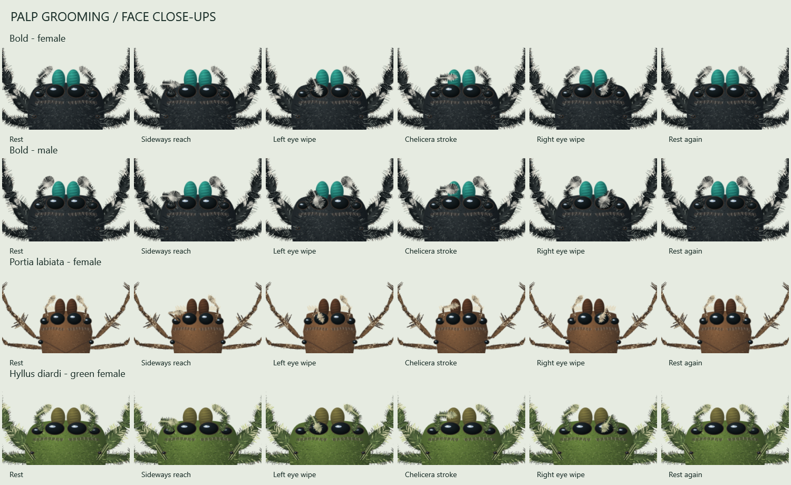

These are **species-inspired procedural illustrations**, not an identification
tool or a full anatomical simulation. The species share desktop play and resting
behavior, with the personality variations and Portia encounter described above. [Reference notes](docs/ART-REFERENCES.md)
explain the artwork choices. No reference photos are bundled.

## Saves, privacy and removal

Preferences, silk progress and meal count stay in
`%LOCALAPPDATA%\CornerSpider\settings.txt`; `.bak` keeps the previous save.
Existing saves migrate automatically. The pet makes no network requests. The optional support button delegates to your
browser; its page is governed by Cash App. There is no telemetry, keyboard
hook, mouse injection or capture. A read-only mouse hook observes button-down edges
and immediately forwards them. It stores no click history.

Quit from the tray or run **Stop-Spider.cmd**. To remove the app, first disable
“Start with Windows”, quit, then delete its folder. Optionally delete its save folder.
If moving an installation with startup enabled, disable startup before moving it
and enable it again from the new location. Startup uses only the current user's
Windows Run key.

Exclusive fullscreen programs can cover the pet. Secure Windows screens take
precedence. Pause is useful during presentations or games.

## Build and check

From this folder on Windows:

```bat
Build.cmd
```

This uses the Windows .NET Framework compiler, executes deterministic behavior,
settings and persistence tests, then compiles the WPF app. No NuGet packages or
asset downloads are required. SupportQr.png is a bundled original QR crop and is
embedded at build time. Quit a running copy before rebuilding it.

Optional local diagnostics:

```bat
JumpingSpider.exe --self-test "C:\Temp\CornerSpiderChecks"
JumpingSpider.exe --desktop-test "C:\Temp\CornerSpiderManual"
JumpingSpider.exe --release-preview "C:\Temp\CornerSpiderArtwork"
JumpingSpider.exe --prey-preview "C:\Temp\CornerSpiderPrey"
JumpingSpider.exe --encounter-preview "C:\Temp\CornerSpiderEncounters"
JumpingSpider.exe --hammock-preview "C:\Temp\CornerSpiderHammock"
JumpingSpider.exe --dismount-preview "C:\Temp\CornerSpiderJump"
JumpingSpider.exe --nest-preview "C:\Temp\CornerSpiderNest"
```

The first runs native overlay/settings/cleanup checks with isolated saves.
The second is an interactive click-through and cursor-play fixture.
The preview commands export artwork without overlays or cursor hiding.
[Verification notes](docs/VERIFICATION.md) distinguish automated checks from manual
work still needed. Physical mixed-DPI changes, real sleep/resume, unplugging a
monitor and hands-on cursor feel should be checked on the release machine.

`Package.ps1` builds and produces the portable ZIP, clean source ZIP and checksums.
It also generates a ready-to-post RELEASE-NOTES.md containing the full changelog,
plus a standalone CHANGELOG.md release attachment.
The included GitHub Actions workflow runs the behavior build and uploads packages;
it does not publish a GitHub Release automatically.

## Contribute and future work

See [CONTRIBUTING.md](CONTRIBUTING.md), [ROADMAP.md](ROADMAP.md) and
[RELEASING.md](RELEASING.md). The project retains C# WPF and .NET Framework 4.8 for
small, dependency-free Windows builds. A modern .NET migration would add a runtime
requirement or a larger self-contained download.

## License

Free software under the [MIT License](LICENSE). Code and original procedural art
are included. Reference photographs remain with their owners and are not distributed.
The supplied payment QR and Cash App branding are identified in [support notes](docs/SUPPORT.md).
