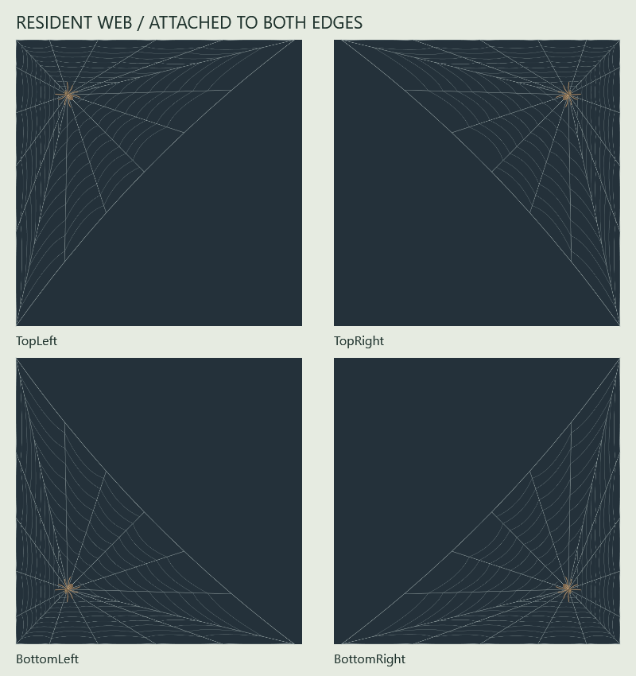

# How Corner Spider developed

Corner Spider was built with AI assistance through repeated rounds of human
direction, implementation, inspection and correction. The creator supplied the
idea, references and feedback about how the spider should look and behave. The
AI coding assistant translated those requests into code, investigated problems,
ran checks and prepared builds for another look. The result changed substantially
as that feedback became more specific.

The first prototype already contained many of the broad features: a Windows
overlay, a procedural spider, hunting, cursor rides, a hammock and local saves.
Its own README also said it had been authored in Linux and had not been compiled
or visually tested on Windows. Making that prototype runnable and convincing
required further development.

## The feedback changed the implementation

| Development stage | What needed attention | What changed |
| --- | --- | --- |
| Windows foundation | Source structure alone did not establish that a desktop overlay worked. | Preserved the prototype, built on Windows, ran behavior checks and added native diagnostics for transparency, click-through behavior, focus, cursor restoration and cleanup. |
| Desktop behavior | The pet needed to use multiple monitors, favor a home corner and remain unobtrusive. | Added all-monitor exploration, a preferred rightmost home, display/DPI handling, corner-oriented movement, a recognizable tray icon and a launch shortcut. |
| Spider appearance | Early results still looked unlike a jumping spider. | Repeatedly revised fuzz, body proportions, face layout, mouthparts and the eight-leg pose. Added longer forelegs and paired forward/upward reaches, with revised joint projection. |
| Movement and attention | Continuous meandering and ignoring a nearby pointer during a long patrol weakened the illusion. | Added short movement bursts, pauses, turns and perches; made cursor attention interrupt patrols and trips home, then resume the route. |
| Finger interaction | A spider pinned to the pointer felt like a dragged object. | Added a timed finger offer, hanging and climbing, gentle carrying, waves and departures. Refined the finger's silhouette, fading hand end, pointer alignment and skin-tone control. |
| Boarding and leaving | Always catching the fingertip and dropping on a click looked awkward. | Added varied upper-surface landings, side-dependent catches, landing compression and planned upward click jumps. Fast movement still causes a quicker startled escape. |
| Sleeping retreat | Walking onto a cocoon and disappearing did not show the spider entering it. | Added a diagonal tucked pose, routing to an end opening, head-first entry, silk occlusion and a visible exit. Saved nest progress remained part of the design. |
| Settings and species | Tray menus and palette-only differences limited usability and variety. | Moved preferences into settings with previews and sliders; expanded to twenty appearance profiles, including sex variants, distinct proportions and articulated grooming palps. |
| Hunting distance | The final hunting jump looked too short. | Increased the shared pounce range for all profiles, retained the notice/stalk/crouch sequence and checked ceiling and monitor-seam behavior. |
| Portia's prey | A different-looking skin needed a meaningful behavioral difference. | Added small-spider prey and a separate encounter where a resident builds silk, waits, responds to repeated web plucks and approaches an ambush. |
| Web encounter staging | The resident needed space; ordinary patrols could overlap its web, and silk faded too soon. | Enlarged the web and resident, reserved the corner, placed Portia at a connected outer strand and delayed fading until Portia had left. |
| Web artwork | Successive meshes looked too geometric, then too loosely attached to the corner. | Reworked the mesh into curved capture silk, gave it eleven direct edge attachments, and finally made the outer span a smooth concave arc. Weaving motion and artwork share the same geometry. |
| Performance and packaging | More detailed translucent artwork introduced rendering cost, and a local executable alone was insufficient for release. | Retained generated silk artwork, batched construction updates, sampled CPU/memory/handles, verified clean ZIP contents and rebuilt extracted source. |

These stages overlapped. A change in appearance could reveal a movement problem;
a new interaction could expose an edge case at a screen boundary. A successful
build was followed by another round of looking at the result and deciding what
still felt wrong.

## One feature took several passes: the resident web

The web provides a compact example of the process. It first needed a readable
build/wait/pluck/hunt sequence. It then needed more space, a larger resident,
separation from normal patrols and a fade that waited for the hunter to leave.
The artwork went through an irregular network, a curved orb-style design, a
corner-supported frame and a smoother inward-curving outer edge.

Those changes also affected where the resident rested, where Portia placed its
front feet and which path the builder followed. The shared geometry and tests
were updated with the visuals. The versioned changes are recorded in the
[complete changelog](../CHANGELOG.md), especially RC1 and RC4-RC8.

## What testing establishes

The project contains deterministic behavior tests, WPF-rendered previews and
native Windows diagnostics. They cover different questions. Simulated hunts can
check timing, capture, screen bounds and interruptions; rendered images help
review anatomy and silk; native checks exercise the Windows overlay, settings,
pointer handling and cleanup.

Large assertion totals include repeated samples across sizes, directions, frame
steps and display scales. They are not counts of distinct features or a guarantee
that every real desktop configuration has been tested. The current
[verification notes](VERIFICATION.md) identify which checks ran for each build,
which results came from an earlier build, and which hands-on checks remain.

## Reading this history

The full changelog preserves the numbered revisions. Earlier prototype work is
grouped where individual build labels are incomplete. Git was initialized at
RC3, so the commit list covers only the later portion of development. Earlier
milestones are reconstructed from preserved project files and development
feedback; this history does not assign invented dates, prompt counts or costs.

The creator's feedback continued to change anatomy, movement and interaction
after the first executable existed. AI-assisted implementation was one part of
that continuing design and testing process.
